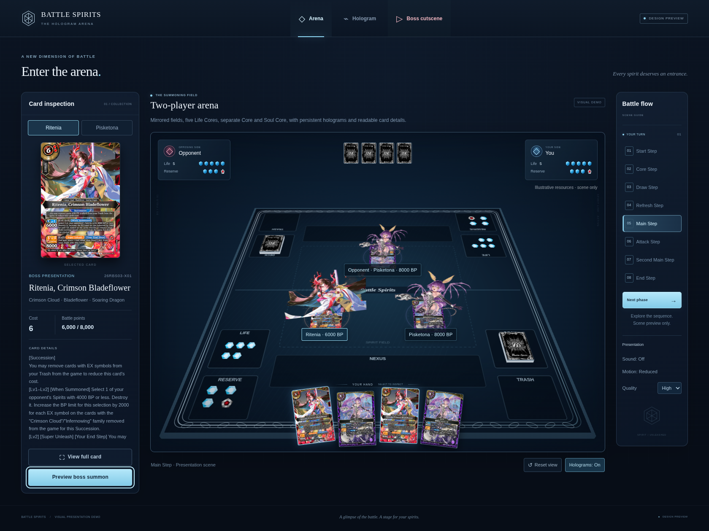
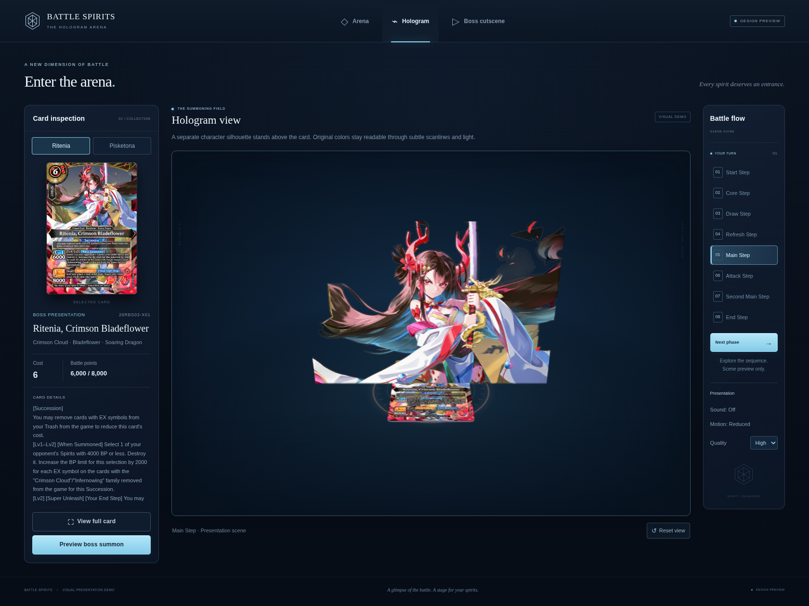
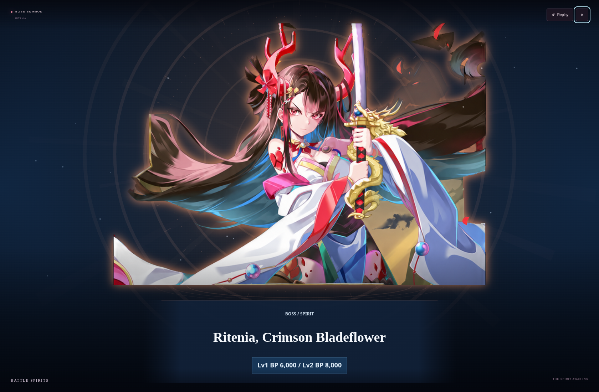

# Battle Spirits — Hologram Arena v1

Bản thiết kế tương tác dựa trên **ba HTML bạn cung cấp**: hologram trên đế thẻ, cutscene triệu hồi riêng cho boss và sàn đấu hai người chơi. **Chưa sửa hay tích hợp vào dự án Unity.**

**[Tải demo ZIP](https://raw.githubusercontent.com/LaoDai060204/Card-Game/review/battle-spirits-english-cards-20261115/design/hologram-arena-v1/battle-spirits-hologram-arena-v1.zip)** · [Bản thiết kế chi tiết](DESIGN.md) · [Nguồn và hash](sources.json)

Giải nén toàn bộ ZIP, mở **`index.html` bằng Chrome hoặc Edge**. Có sẵn Three.js và hình ảnh trong gói; bản demo không cần CDN. Tệp `standalone.html` cũng chứa toàn bộ tài nguyên để mở riêng. GitHub chỉ hiển thị mã HTML, không chạy demo trong trang xem mã.

## Sàn đấu

- Chọn thẻ trên tay, nhân vật trên sân hoặc nút tên để xem thông tin bên trái; **View full card** mở thẻ lớn.
- **Arena:** hai phía đối xứng, thẻ nằm ngang, nhân vật đứng riêng trên thẻ, thông tin Life/Core/Soul Core dễ phân biệt. Nút Holograms bật/tắt nhân vật để so sánh, vẫn giữ đế thẻ.
- **Hologram:** kéo để xoay góc nhìn, cuộn để zoom; có thể đổi giữa Ritenia và Pisketona.
- **Boss cutscene:** Ritenia có đoạn triệu hồi khoảng 4,2 giây, tên/BP, Replay, Skip và đóng bằng Escape. Preview boss summon trên sân phát cutscene rồi trả về hologram; Pisketona dùng hiệu ứng cục bộ ngắn trong bản minh họa này.
- Sound mặc định tắt; có Motion Reduced và Quality Low. Khi giảm chuyển động, nhân vật và cutscene có bố cục tĩnh, không rung/nháy; dựng hình 3D dừng khi tab ẩn hoặc đang xem cutscene.

## Hologram

Đây là **nhân vật 2.5D tách nền**, luôn xoay về camera, đứng trên đế thẻ 3D. Hai mẫu có sẵn; chưa tạo model/rig cho toàn bộ bộ thẻ. Ảnh Pisketona được tách lại vì crop trong HTML nguồn vẫn chứa nền và góc khung. [PNG đã tách](https://raw.githubusercontent.com/LaoDai060204/Card-Game/review/battle-spirits-english-cards-20261115/design/hologram-arena-v1/assets/pisketona-isolated.png) có alpha thật; ảnh nguồn giữ nguyên.

## Boss cutscene

Ritenia dùng dữ liệu English đã có cho **26RBS03-X01**, Cost 6, BP 6000/8000. Trang hologram nguồn có nhãn Pisketona/BP 8000/11000 đi cùng artwork Ritenia; bản mới đồng bộ lại đúng thẻ. Pisketona dùng thẻ Nhật gốc, BP 8000/11000, kèm phần đọc hiệu ứng English không chính thức trong bảng thông tin; chưa tạo ảnh thẻ English mới cho lá này.

## Phạm vi review

- Tám bước Standard được hiển thị, có **Second Main Step**. Các nút phase chỉ đổi trạng thái trình bày; không chạy luật, tính cost, xử lý hiệu ứng hay mô phỏng trận đấu.
- Life 5 và Reserve 3 Core xanh + 1 Soul Core tâm đỏ/viền bạc là các chỉ báo minh họa. Trạng thái có nhân vật sẵn trên sân không phải dữ liệu trận đấu hợp lệ đã được engine xác nhận.
- Boss là metadata trình bày riêng. Việc gán Ritenia/Pisketona hai chế độ ở đây phục vụ so sánh, không phải phân loại chính thức hoặc danh sách boss cuối cùng.
- Giữ đủ ba HTML gốc trong `originals`, không chỉnh nội dung; các ảnh nhúng được giải mã giữ nguyên byte trong `assets`. PNG Pisketona mới là tài nguyên dẫn xuất bằng công cụ hình ảnh, không phải bản cắt mask pixel chính xác.
- Các khung PNG, 61 thẻ English, 16 ảnh từ design.7z và các nhánh game trước đó không đổi.

Nguồn thẻ/illustration: Battle Spirits © BNP/BANDAI. Đây là demo không chính thức. Three.js r128 dùng giấy phép MIT; bản giấy phép ở `vendor/THREE-LICENSE.txt`.
