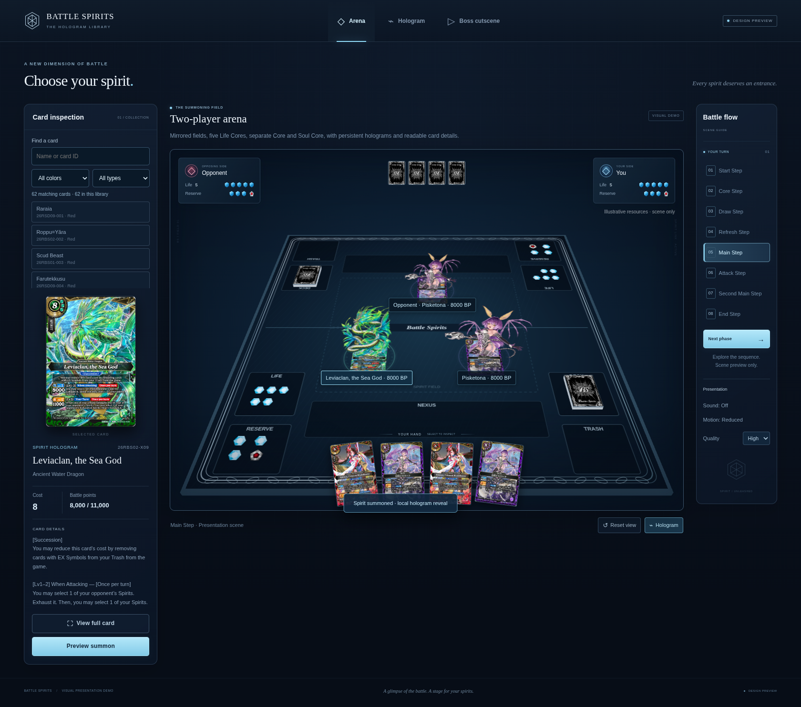
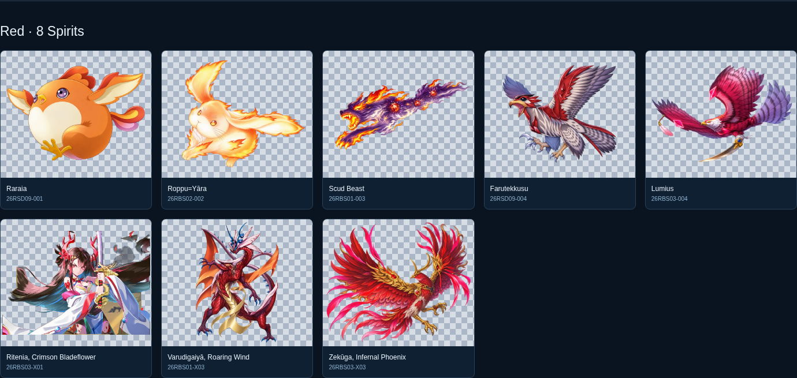
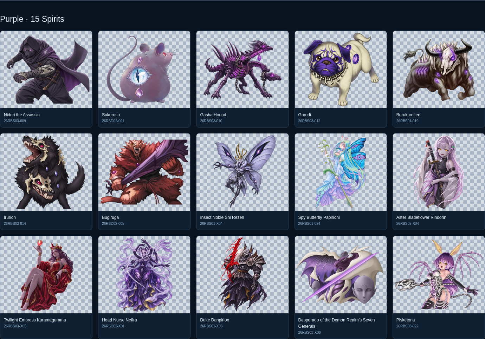
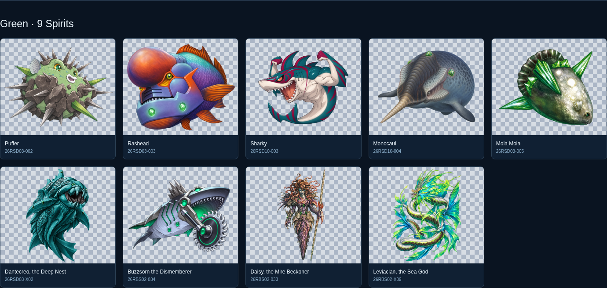
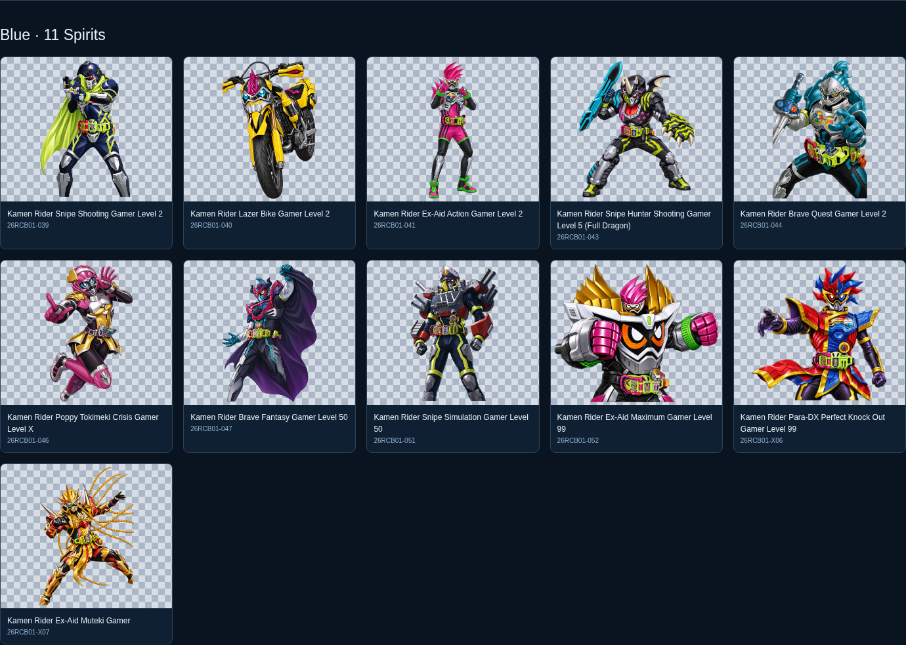

# Battle Spirits — Hologram Library v2

**Đã thêm 41 nhân vật tách nền**, đủ **43 hologram** gồm 42 thẻ Spirit trong bộ bốn deck đã lưu và Pisketona từ mẫu riêng. Hai ảnh Ritenia/Pisketona cũ giữ nguyên. **19 thẻ Nexus/Magic** có trong thư viện để soi thông tin và giữ dạng thẻ phẳng. Chưa sửa dự án Unity.

**[Tải đủ 43 PNG trong suốt](https://raw.githubusercontent.com/LaoDai060204/Card-Game/review/battle-spirits-english-cards-20261115/design/hologram-library-v2/spirit-cutouts-43.zip)** · [Danh mục, nguồn và hash](library.json)

## Xem và chạy demo

Giải nén một trong các gói bên dưới rồi mở **index.html** bằng Chrome/Edge. Mỗi gói chứa hình thẻ, cutout và thư viện Three.js, chạy offline không cần CDN. Các gói theo màu đều giữ thêm Ritenia/Pisketona để xem lại hai mẫu và tuyến boss. GitHub hiển thị mã HTML, không chạy bản demo trực tiếp trong trang xem mã.

| Gói demo | Spirit thuộc màu | Nội dung |
| --- | ---: | --- |
| [Red — tải ZIP](https://raw.githubusercontent.com/LaoDai060204/Card-Game/review/battle-spirits-english-cards-20261115/design/hologram-library-v2/hologram-red-v2.zip) | 8 | Thẻ cùng màu, mẫu Ritenia/Pisketona, bộ lọc và soi thẻ |
| [Purple — tải ZIP](https://raw.githubusercontent.com/LaoDai060204/Card-Game/review/battle-spirits-english-cards-20261115/design/hologram-library-v2/hologram-purple-v2.zip) | 15 | Thẻ cùng màu, mẫu Ritenia/Pisketona, bộ lọc và soi thẻ |
| [Green — tải ZIP](https://raw.githubusercontent.com/LaoDai060204/Card-Game/review/battle-spirits-english-cards-20261115/design/hologram-library-v2/hologram-green-v2.zip) | 9 | Thẻ cùng màu, mẫu Ritenia/Pisketona, bộ lọc và soi thẻ |
| [Blue — tải ZIP](https://raw.githubusercontent.com/LaoDai060204/Card-Game/review/battle-spirits-english-cards-20261115/design/hologram-library-v2/hologram-blue-v2.zip) | 11 | Thẻ cùng màu, mẫu Ritenia/Pisketona, bộ lọc và soi thẻ |

- Tìm bằng tên hoặc mã thẻ; bộ lọc màu/Spirit/Nexus/Magic có thể dùng cùng lúc. Chọn thẻ để đổi nhân vật bên trái sân và bảng thông tin. Chọn **View full card** để đọc thẻ lớn.
- **Hologram** cho xoay/zoom nhân vật; vùng alpha dư được căn bằng UV khi dựng hình, không sửa byte PNG. Nhân vật quá rộng được thu vừa sân.
- Chỉ tải hình khi chọn; giữ tối đa sáu cặp texture thẻ/nhân vật, giải phóng những cặp không dùng. Các lần chọn nhanh giữ kết quả của lần chọn cuối; tệp lỗi có thông báo và có thể chọn lại để thử.
- **Ritenia vẫn là mẫu boss duy nhất.** Những lá mới dùng hiệu ứng triệu hồi tại chỗ. Không tự suy boss từ rarity/Cost/BP; danh sách boss tiếp theo cần được chốt riêng.
- Có giảm chuyển động, Quality Low, âm thanh tắt mặc định, Skip/Escape cho cutscene. Tài nguyên/phase chỉ là trình bày, không chạy luật trận đấu.

## 43 ảnh nhân vật

Nền ô caro chỉ nằm trong các ảnh xem trước. PNG tải về có alpha thật; không dùng screenshot làm tài nguyên game.

### Red — 8

### Purple — 15

### Green — 9

### Blue — 11

## Nguồn và phạm vi

- 41 PNG mới được phục dựng/tách nhân vật bằng công cụ hình ảnh từ ảnh thẻ gốc đúng mã. Đã kiểm tra silhouette, alpha và đối chiếu nguồn; đây là tài nguyên review, không phải mask pixel chính xác hay mesh/rig 3D có khối.
- Hai PNG cũ giữ nguyên byte. Riêng cutout Ritenia do người dùng cung cấp vẫn có vài mảng bầu trời và một viền tên mỏng; đây là giới hạn của mẫu cũ, không được gọi là bản đã làm sạch trong đợt này.
- Toàn bộ 61 ảnh English và ảnh gốc trước đó, 18 khung, 16 ảnh design.7z và bản demo v1 giữ nguyên. Pisketona vẫn dùng ảnh thẻ Nhật gốc với phần đọc English không chính thức trong inspector; không tạo ảnh thẻ English mới cho lá này.
- Đủ tám bước Standard, có Second Main. Core xanh và Soul Core tâm đỏ/viền bạc giữ định danh riêng với Symbol in trên thẻ.

[Danh sách 62 thẻ và nguồn](library.json) · [Các PNG riêng](cutouts) · [Thiết kế ban đầu](../hologram-arena-v1/DESIGN.md) · [Demo v1](../hologram-arena-v1/README.md)

Battle Spirits © BNP/BANDAI. Nguồn illustration được giữ trong ảnh thẻ gốc và danh mục. Tài nguyên review không chính thức; Three.js r128 theo giấy phép MIT.
