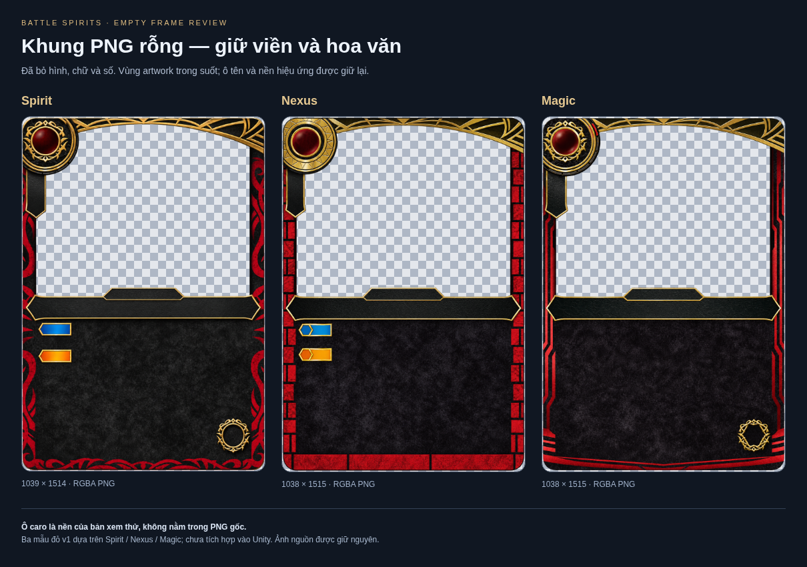
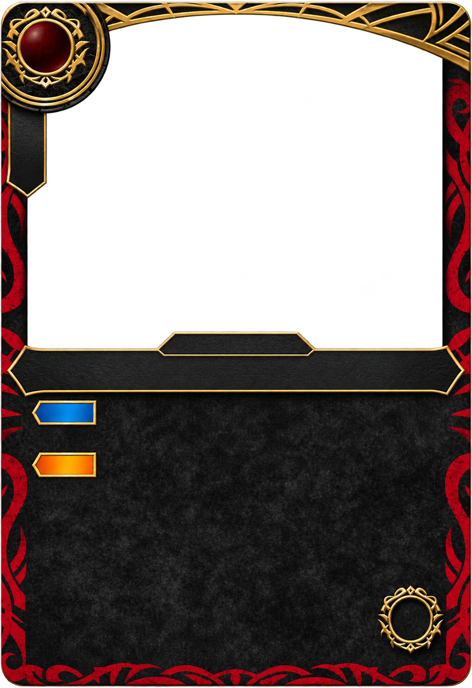
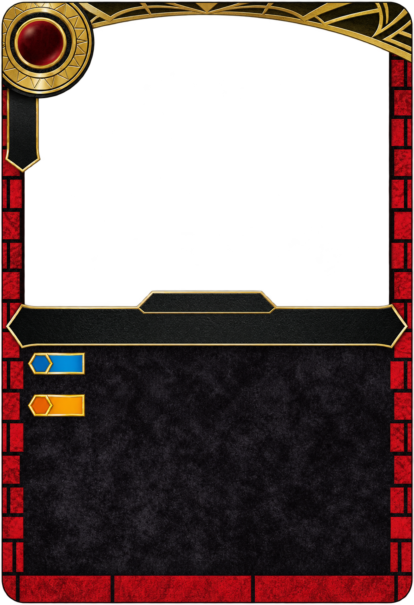
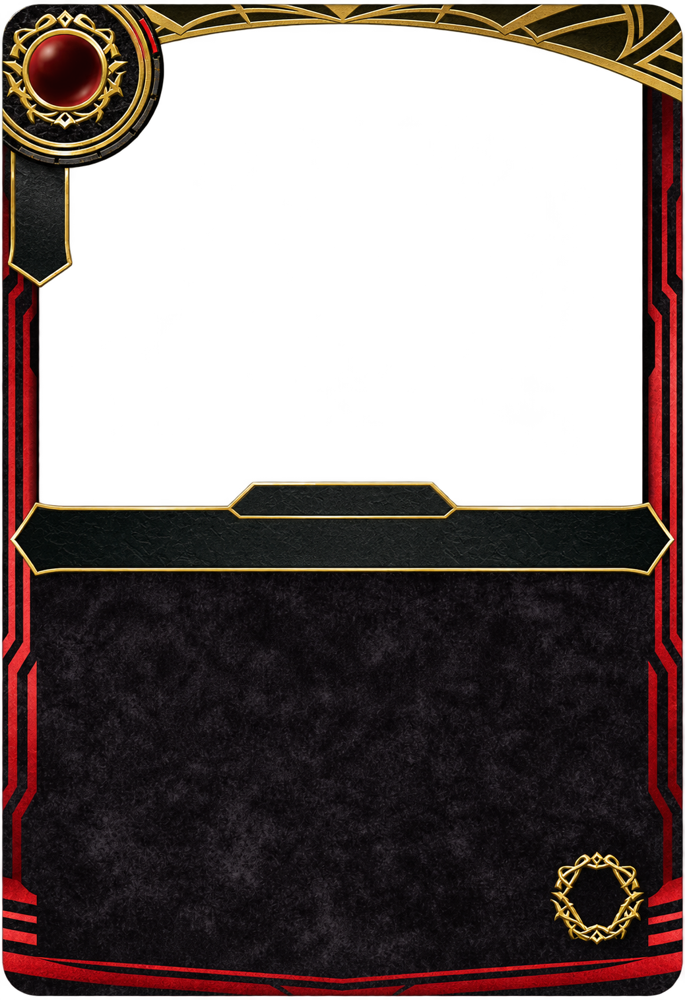

# Khung thẻ PNG rỗng — mẫu đỏ v1

Theo lựa chọn của bạn: **bỏ artwork, chữ và số; giữ viền, hoa văn và các ô nền**. Đã tạo ba mẫu dựa trên các thẻ Spirit, Nexus, Magic đang có. Các màu khác chưa được tạo trong bộ này.

Vùng artwork và phần ngoài góc bo có alpha trong suốt; các bảng tên, chi phí và nền hiệu ứng được giữ lại để đặt nội dung sau. Không có số Cost, số giảm phí, tên thẻ, BP, nội dung hiệu ứng hoặc biểu tượng ngọc màu cố định trên các PNG.

**Ảnh trên chỉ là bản xem thử có nền ô caro. Các PNG gốc bên dưới không chứa nền ô caro.**

| Loại | PNG gốc | Kích thước | Ô Level trống |
| --- | --- | --- | ---: |
| Spirit | [Tải PNG trong suốt](https://raw.githubusercontent.com/LaoDai060204/Card-Game/review/battle-spirits-english-cards-20261115/frames/red-base-v1/card-frame-spirit-red.png) | 1039 × 1514 | 2 |
| Nexus | [Tải PNG trong suốt](https://raw.githubusercontent.com/LaoDai060204/Card-Game/review/battle-spirits-english-cards-20261115/frames/red-base-v1/card-frame-nexus-red.png) | 1038 × 1515 | 2 |
| Magic | [Tải PNG trong suốt](https://raw.githubusercontent.com/LaoDai060204/Card-Game/review/battle-spirits-english-cards-20261115/frames/red-base-v1/card-frame-magic-red.png) | 1038 × 1515 | 0 |

[Tải ZIP ba khung và bản xem thử](https://raw.githubusercontent.com/LaoDai060204/Card-Game/review/battle-spirits-english-cards-20261115/frames/red-base-v1/red-frames-v1.zip)

Giải nén ZIP rồi mở `preview.html` để xem vùng trong suốt trên nền ô caro. Các tệp `card-frame-*.png` là tài nguyên khung.

## Ba tệp khung

### Spirit

Nguồn: [26RBS03-004 — Lumius](https://github.com/LaoDai060204/Card-Game/blob/review/battle-spirits-english-cards-20261115/original-cards/26RBS03-004.webp)

### Nexus

Nguồn: [26RSD09-011 — Gorge of Mighty Winds](https://github.com/LaoDai060204/Card-Game/blob/review/battle-spirits-english-cards-20261115/original-cards/26RSD09-011.webp)

### Magic

Nguồn: [26RSD01-012 — Break Claw](https://github.com/LaoDai060204/Card-Game/blob/review/battle-spirits-english-cards-20261115/original-cards/26RSD01-012.webp)

## Nội dung đã tách

- Giữ phần khung vàng/đen/đỏ, họa tiết viền, vòng Cost trống, cờ loại thẻ trống và hai bảng tên/hệ trống.
- Spirit giữ hai ô Level màu xanh/cam, đã bỏ toàn bộ chữ và số; nền để BP không có số cố định.
- Nexus giữ hai ô Level trống và không thêm BP.
- Magic không có ô Level/BP; bỏ các biểu tượng và nhãn Main/Flash của lá nguồn.
- Ngọc gameplay đã được bỏ. Các vòng trang trí ở vị trí Symbol của Spirit/Magic được giữ như ô trống; chưa đặt Normal Symbol hoặc EX Symbol.

## Phạm vi bản v1

Đây là mẫu khung được tách/phục dựng bằng công cụ hình ảnh từ thẻ tham chiếu, không phải mask sao chép chính xác từng pixel. Kích thước và vài nét viền có thể khác nguồn; xem thử trước khi chốt texture để tích hợp. Các viền được khử răng cưa và có pixel alpha gần trong suốt; số đo thực tế được ghi trong [frames.json](frames.json).

Ảnh thẻ nguồn và bộ 61 ảnh English vẫn được giữ nguyên. Chưa tạo prefab, mã hiển thị hoặc thay đổi dự án Unity trong lần này.

Derived from Battle Spirits card design © BNP/BANDAI. Original source images and illustration credits are preserved with the source files. Unofficial review assets.

[Quay lại trang review](https://github.com/LaoDai060204/Card-Game/tree/review/battle-spirits-english-cards-20261115) · [Ghi nhớ thiết kế](https://github.com/LaoDai060204/Card-Game/blob/review/battle-spirits-english-cards-20261115/design/DESIGN_MEMORY.md)
