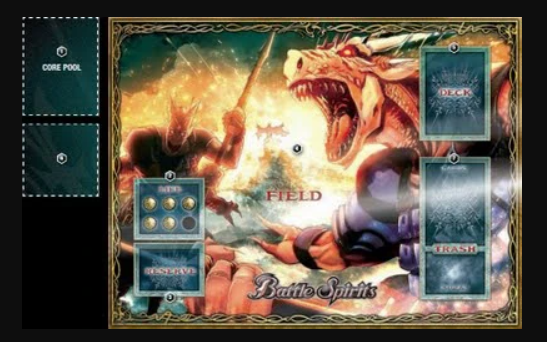

# 16 ảnh tham chiếu Core, Symbol, mặt sau và sàn đấu

**Đã upload đủ 16/16 ảnh PNG nguyên bản từ `design.7z`.** Giữ nguyên nội dung và tên tệp được cung cấp, gồm cả dấu cách. Không cắt, vẽ lại, dịch hoặc xử lý nền trong lần lưu này.

**[Tải lại design.7z nguyên bản — 7,8 MB](https://raw.githubusercontent.com/LaoDai060204/Card-Game/review/battle-spirits-english-cards-20261115/references/core-field-20261115/design.7z)** · [Mở thư mục ảnh](originals) · [Hash và thông tin tệp](archive-manifest.json)

Bấm ảnh để mở bản đầy đủ. Các ảnh này là tham chiếu người dùng cung cấp; các poster/sơ đồ lịch sử được phân loại riêng, không tự thay thế luật Standard hiện hành.

## Xem ảnh

### 01. Viên ngọc Symbol xanh dương

[`Blue core.png`](originals/Blue%20core.png) · 520 × 596 px · `BS-REF-20261115-01`

### 02. Mặt sau Battle Spirits đen với hoa văn bạc

[`BS back.png`](originals/BS%20back.png) · 662 × 912 px · `BS-REF-20261115-02`

### 03. Core xanh và Soul Core tâm đỏ, viền bạc

[`Core and Soul Core.png`](originals/Core%20and%20Soul%20Core.png) · 711 × 415 px · `BS-REF-20261115-03`

### 04. Sàn đấu artwork rồng, khung vàng

[`Field.png`](originals/Field.png) · 547 × 342 px · `BS-REF-20261115-04`

### 05. Sơ đồ chuẩn bị trận đấu đánh số 1–5

[`Game Preparation.png`](originals/Game%20Preparation.png) · 1210 × 501 px · `BS-REF-20261115-05`

### 06. Viên ngọc Symbol xanh lá

[`Green core.png`](originals/Green%20core.png) · 505 × 542 px · `BS-REF-20261115-06`

### 07. Hướng dẫn bộ bài, Core và Soul Core

[`Items Needed for A Game.png`](originals/Items%20Needed%20for%20A%20Game.png) · 955 × 707 px · `BS-REF-20261115-07`

### 08. Sàn đen viền bạc với 8 bước của lượt

[`Play Sheet.png`](originals/Play%20Sheet.png) · 960 × 671 px · `BS-REF-20261115-08`

### 09. Sàn xám có vùng Burst và 7 bước

[`Playsheet w.png`](originals/Playsheet%20w.png) · 1257 × 891 px · `BS-REF-20261115-09`

### 10. Viên ngọc Symbol tím

[`Purple core.png`](originals/Purple%20core.png) · 510 × 581 px · `BS-REF-20261115-10`

### 11. Viên ngọc Symbol đỏ

[`Red core.png`](originals/Red%20core.png) · 562 × 547 px · `BS-REF-20261115-11`

### 12. Poster luật English có Brave, Burst và 7 bước

[`Rule Sheet1.png`](originals/Rule%20Sheet1.png) · 1000 × 712 px · `BS-REF-20261115-12`

### 13. Sơ đồ giải thích các vùng thông tin trên thẻ

[`Spirit rule.png`](originals/Spirit%20rule.png) · 1247 × 792 px · `BS-REF-20261115-13`

### 14. Bảng 6 Symbol thường và 6 EX Symbol

[`Symbols .png`](originals/Symbols%20.png) · 677 × 627 px · `BS-REF-20261115-14`

### 15. Viên ngọc Symbol trắng/bạc

[`White core.png`](originals/White%20core.png) · 585 × 581 px · `BS-REF-20261115-15`

### 16. Viên ngọc Symbol vàng

[`Yellow core.png`](originals/Yellow%20core.png) · 502 × 582 px · `BS-REF-20261115-16`

## Danh mục và ghi nhớ

| Thứ tự | Tệp gốc | Vai trò / lưu ý |
| ---: | --- | --- |
| 01 | [Blue core.png](originals/Blue%20core.png) | Printed Blue Symbol; preserve its distinction from a physical regular Core. |
| 02 | [BS back.png](originals/BS%20back.png) | Card-back artwork reference; retain the original border and proportions when original bytes are supplied. |
| 03 | [Core and Soul Core.png](originals/Core%20and%20Soul%20Core.png) | Regular Core and Soul Core resource-piece shapes; matches the existing blue/red preference. |
| 04 | [Field.png](originals/Field.png) | Illustrated field and zone-layout reference; format provenance not established from this screenshot alone. |
| 05 | [Game Preparation.png](originals/Game%20Preparation.png) | Void, Deck, five Life Cores, three regular Cores plus one Soul Core in Reserve, four-card Hand. |
| 06 | [Green core.png](originals/Green%20core.png) | Printed Green Symbol. |
| 07 | [Items Needed for A Game.png](originals/Items%20Needed%20for%20A%20Game.png) | Deck stack/card back and physical resource pieces; Japanese labels: Deck; Core and Soul Core. |
| 08 | [Play Sheet.png](originals/Play%20Sheet.png) | Standard-compatible turn sequence, including Second Main Step. |
| 09 | [Playsheet w.png](originals/Playsheet%20w.png) | Historical/Eternal visual reference; do not use its sequence as the current Standard rules. |
| 10 | [Purple core.png](originals/Purple%20core.png) | Printed Purple Symbol. |
| 11 | [Red core.png](originals/Red%20core.png) | Printed Red Symbol; distinct from the red-centered Soul Core resource piece. |
| 12 | [Rule Sheet1.png](originals/Rule%20Sheet1.png) | Older/Eternal quick-rules reference; not the governing Standard ruleset. |
| 13 | [Spirit rule.png](originals/Spirit%20rule.png) | Cost, reductions, card type/name/family, levels, effects, symbols and card details; the older example is not proof of Standard legality. |
| 14 | [Symbols .png](originals/Symbols%20.png) | Normal and gold-framed EX Symbols in six colors; screenshot Legacy wording is not the canonical English keyword Succession. |
| 15 | [White core.png](originals/White%20core.png) | Printed White Symbol. |
| 16 | [Yellow core.png](originals/Yellow%20core.png) | Printed Yellow Symbol. |

- **Core thường:** khối màu xanh ở ảnh 03. **Soul Core:** tâm đỏ với viền bạc trong cùng ảnh. Chúng là tài nguyên trên sân.
- Các viên ngọc sáu màu và các phiên bản viền vàng là **Symbol / EX Symbol trên thẻ**. Giữ nguyên tên tệp gốc như `Blue core.png`, nhưng phân biệt vai trò theo hình và bảng chú giải, không chỉ theo tên tệp.
- Standard hiện hành có **8 bước**, gồm **Second Main Step**. Sơ đồ đen ảnh 08 có trình tự này.
- Các sơ đồ bảy bước/Burst/Brave ở ảnh 09 và 12 được lưu làm tham khảo lịch sử/Eternal; luật triển khai lấy từ tài liệu Standard chính thức.
- Chuẩn bị trận: **5 Core thường ở Life; 3 Core thường + 1 Soul Core ở Reserve; 4 lá trên tay**. Sáu ô trên thảm không đổi số Life khởi đầu thành sáu.
- Chú giải ghi “Legacy”; bộ thẻ English dùng thuật ngữ chính thức **Succession**.
- Chưa có ảnh nào được đưa vào dự án Unity trong lần lưu này. Tài nguyên đã xử lý sau này sẽ là tệp riêng; ảnh gốc và `design.7z` được giữ nguyên.

[Ghi nhớ thiết kế](../../design/DESIGN_MEMORY.md) · [Dữ liệu tham chiếu](references.json) · [Quay lại trang review](../../README.md)

Nguồn luật: [Official Standard Rule Manual](https://asia-en.battlespirits.com/pdf/official-rule-manual_standard.pdf?ver.1.0) · [Trang luật Nhật](https://www.battlespirits.com/rule/)
